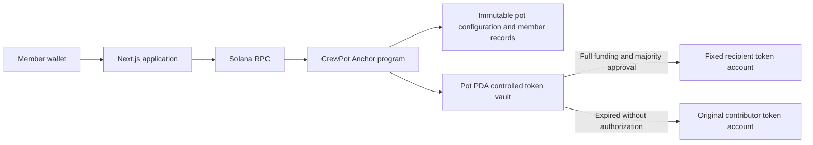

# CrewPot

**Your crew. Your money. Your rules.**

CrewPot lets a small group pool tokens for a shared goal without giving one member unilateral access to the vault. Everyone agrees on an equal contribution, a fixed recipient, a deadline, and a strict-majority approval threshold. The Solana program enforces that agreement.

If the round is not authorized before its deadline, contributors can reclaim their own deposits. After authorization, anyone can finalize payment to the agreed recipient—even after the deadline.

## Current status

- Implemented: five Anchor instructions, fixed membership, token vaults, approvals, payouts, refunds, wallet integration, pot creation/review, dashboard, pot details, transaction feedback, Explorer links, responsive styles, and SVG branding.
- Verified: 55 compiled-program LiteSVM tests; 19 amount and UI-state tests; TypeScript; production frontend build; local-validator funding/payout/refund lifecycle with balance assertions and transaction signatures.
- Local preview for this session: **http://127.0.0.1:3002**. The development server selects another port if the requested port is occupied.
- Local program: `CV7eUQCnNZ9wYereuWFMG98sTDNp5k4QsSPF5rzqUgba`.
- Devnet: not deployed. The public faucet did not fund the deployer.
- GitHub and public frontend: deferred at the developer’s request.
- Browser visual QA and wallet-extension signing: not verified; browser-control services were unavailable.
- Demo video and screenshots: pending. No fabricated transaction evidence or screenshots are included.

This is a Devnet/localnet hackathon prototype, not an audited production system. **Demo USDC (dUSDC) has no real monetary value and is not Circle-issued USDC.**

## Product rules

1. Two to six unique member wallets; the creator must be included.
2. One exact contribution per member. Integer token base units only.
3. Membership, amount, mint, deadline, approval threshold, and recipient are immutable.
4. Voting opens only when every member has contributed. Each contributor may approve once.
5. Quorum must be a strict majority. No votes or contributions at or after the deadline.
6. Once quorum is recorded, payout remains executable after expiry. No refunds after authorization.
7. Without authorization, contributors can refund at or after the deadline, once each, without the creator.
8. The recipient may be outside the group; the interface calls this out.
9. No CrewPot fees. Network fees and account rent are separate.

The MVP accepts classic SPL Token mints with six decimals and no freeze authority. The UI uses the configured demo mint. Token-2022 is not supported.

## Architecture



The pot PDA uses `pot`, creator public key, and a little-endian `u64` identifier. Its canonical associated token account holds deposits. Onchain state, never browser state or raw vault balance, controls eligibility and authorization. [Architecture and limitations](docs/architecture.md) explain the invariants and trust boundaries.

## Stack

- Next.js 16 App Router, React 19, TypeScript, Tailwind CSS 4, Lucide.
- Rust, Anchor 1.2.2, SPL Token, canonical associated token accounts.
- Anchor’s generated IDL and `@anchor-lang/core`; compatible legacy `@solana/web3.js` v1 and Wallet Standard-aware wallet adapters.
- LiteSVM for deterministic compiled-program tests; local validator for RPC integration.
- No database, backend custody, centralized refund scheduler, or platform fee.

The browser build uses Webpack because Anchor’s browser distribution contains a Node-only `fs` reference; the frontend disables that import and signs exclusively through the connected wallet.

## Local setup

Prerequisites: Node 24, npm, Rust, Solana CLI, Anchor 1.2.2. Installed tool versions and verification are recorded in [progress](docs/progress.md).

```sh
npm ci
npm run contract:build
npm run contract:test
npm test
```

Start a validator in a separate terminal:

```sh
solana-test-validator --ledger /tmp/crewpot-development-ledger --bind-address 127.0.0.1
```

Set up disposable local demo wallets and tokens:

```sh
SOLANA_RPC_URL=http://127.0.0.1:8899 npm run demo:setup
solana program deploy --url http://127.0.0.1:8899 \
  --keypair ~/.config/solana/crewpot-deployer.json \
  --program-id target/deploy/crewpot-keypair.json target/deploy/crewpot.so
SOLANA_RPC_URL=http://127.0.0.1:8899 npm run demo:verify
```

The setup script creates private keys outside the repository under `~/.config/solana/crewpot-demo/localnet/`, and writes a **public** `manifest.json` with the mint and member addresses. It is repeatable and tops balances up to 1,000 dUSDC instead of creating a new mint every run. Never commit, paste into chat, or expose those private keys in application code.

On a fresh checkout, Anchor creates a new local program keypair. If its address differs from the checked-in program ID, run `anchor keys sync`, then `npm run contract:build` and update `NEXT_PUBLIC_PROGRAM_ID`. Do not lose or replace a deployed program’s keypair inadvertently.

Copy `.env.example` to `.env.local`, then set:

```dotenv
NEXT_PUBLIC_SOLANA_CLUSTER=localnet
NEXT_PUBLIC_SOLANA_RPC_URL=http://127.0.0.1:8899
NEXT_PUBLIC_PROGRAM_ID=CV7eUQCnNZ9wYereuWFMG98sTDNp5k4QsSPF5rzqUgba
NEXT_PUBLIC_DEMO_MINT=<mint from manifest.json>
```

```sh
npm run dev -- --port 3002
```

Open the printed local URL. Reading a pot does not require connecting a wallet. For browser transactions use a compatible wallet on the matching network with funded demo tokens and SOL. The CLI verification script can independently run the whole lifecycle with its dedicated demo signers.

## Environment variables

| Variable | Purpose |
| --- | --- |
| `NEXT_PUBLIC_SOLANA_CLUSTER` | `devnet` or `localnet` |
| `NEXT_PUBLIC_SOLANA_RPC_URL` | Public RPC endpoint; never embed secret credentials |
| `NEXT_PUBLIC_PROGRAM_ID` | Must match the generated IDL |
| `NEXT_PUBLIC_DEMO_MINT` | Six-decimal, freeze-authority-free demo SPL mint |
| `SOLANA_RPC_URL` | Script endpoint; defaults to official Devnet |
| `CREWPOT_KEYPAIR_PATH` | Script-only deployer keypair path, outside the repository |
| `CREWPOT_DEMO_DIR` | Script-only location for demo signers, mint authority, and manifest |

`NEXT_PUBLIC_` values are public and compiled into the browser bundle. Change them and rebuild before deploying to another network. Scripts deliberately do not infer their network from `.env.local`.

## Verification

```sh
npm run typecheck
npm test
npm run contract:build
npm run contract:test
npm run build
SOLANA_RPC_URL=http://127.0.0.1:8899 npm run demo:verify
```

[Local transaction evidence](docs/localnet-verification.json) records actual signatures and balance assertions. These are **localnet**, not Devnet Explorer evidence. The report covers an early rejected payout, three deposits, two approvals, exact payout, double-payout rejection, early rejected refund, exact refund, and double-refund rejection.

## Deployment and demo

See [deployment](docs/deployment.md) for Devnet and future hosting steps, and [demo script](docs/demo-script.md) for the two-minute presentation. Public demo URL, GitHub repository, Devnet program confirmation, and video URL remain pending.

Brand assets are in `public/branding/`: standalone marks, horizontal/stacked logos for light and dark backgrounds, and an SVG favicon.

## Known limitations

- The program remains upgradeable by its deployment authority. The current instructions have no administrative withdrawal, but upgrade authority remains a trust assumption until revoked after final testing.
- No external audit; dependencies include unresolved inherited advisories. See [security notes](docs/security.md).
- Raw SPL transfers into a vault do not count as contributions. Excess unsolicited tokens and account rent have no sweep/close path in this MVP.
- The mint authority can issue more valueless demo tokens. It is never shipped to the browser.
- Dashboard discovery scans program accounts and filters membership client-side; unsuitable for large-scale indexing.
- Activity lists recent confirmed signatures, not a complete archival event index.
- RPC availability and wallet support affect UI reliability. A timeout is shown as unresolved; users must check the transaction before retrying.
- An authorized representative controls funds after payout. CrewPot does not enforce the purchase or resolve disputes.

Future work, after review and audits: scalable discovery, reminders, more token options, carefully designed account closure, and flexible rounds. Lending, yield, swaps, mainnet, and identity verification are outside this MVP.

## AI-assisted development

Built by Anthony Nwazota with Codex assistance for implementation, tests, documentation, and original SVG/UI work. Final event-specific disclosure and eligibility requirements must be reviewed before submission. Development began on November 6, 2026 before the published 6 PM WAT hacking start, following the developer’s updated instruction; eligibility has not been confirmed with organizers.
