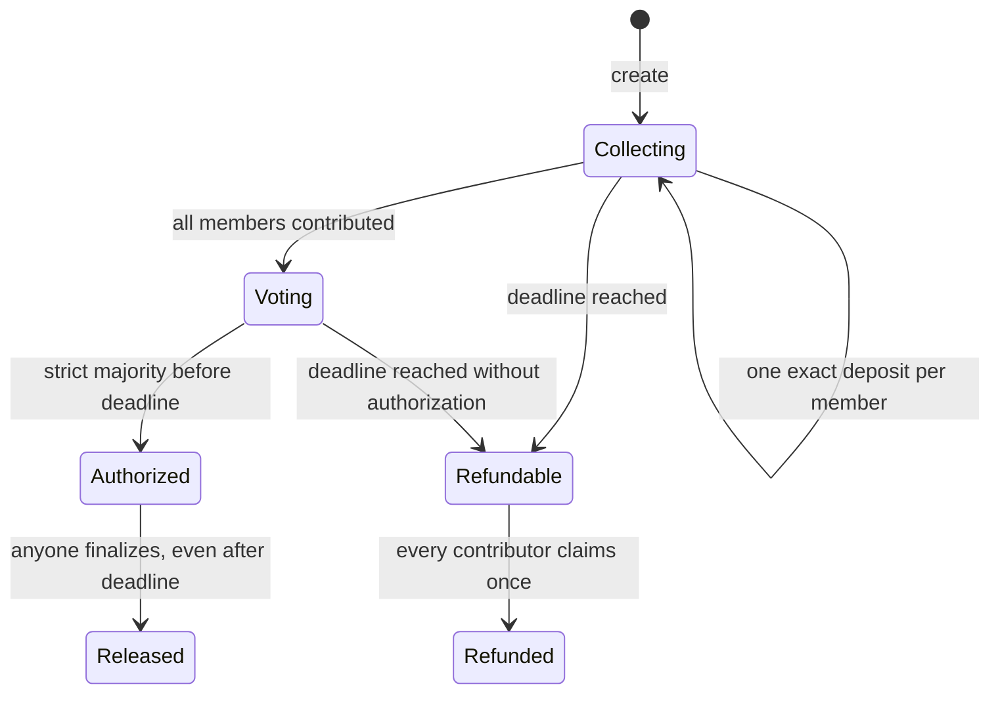

# CrewPot architecture

## State and authority

`programs/crewpot/src/lib.rs` is the source of truth. `PotAccount` stores configuration, historical contribution totals, refunded totals, funded/approval counts, authorization/release flags, and at most six member records. Metadata is bounded by UTF-8 bytes (64 for title, 280 for description); Anchor `InitSpace` sizes the account.

The pot PDA derives from `[b"pot", creator, pot_id.to_le_bytes()]`. Each pot’s canonical ATA uses that PDA as authority and the pot’s immutable mint. Token transfers use the classic SPL program and checked decimals. Outgoing transfers use PDA signer seeds; client-provided destination ownership and mint are checked onchain.

## State transitions

No instruction modifies immutable rules. No path transitions an authorized pot to refundable. Expiry is derived from the chain clock when instructions execute; it does not require a cron task.

At `now == deadline`, deposits and votes fail, refunds become eligible. `payout_authorized` can only be set by a valid pre-deadline approval. Release deliberately has no deadline restriction. Solana serializes writes to the same pot account; checks and token CPI updates are atomic.

`total_contributed` is historical and does not fall on refund. `total_refunded` provides a separate accounting total. Eligibility uses member flags and funded count, never an unsolicited vault balance. Release transfers exactly the target; refunds transfer exactly the contribution.

## Frontend

`lib/contracts/` contains generated IDL and types copied after `anchor build`. `lib/solana.ts` contains reads, transaction builders, network checks, and error mapping. Presentation lives in `app/` and `components/`. No private key is available to the frontend.

Reads use confirmed commitment. The detail page refreshes state and network time and reads balances from token accounts. Before signing, the transaction hook checks the network and deployed program, sets a current blockhash, and asks the wallet to sign. It waits for network confirmation before marking success. Unresolved confirmations preserve the signature for investigation; a failed post-confirmation refresh never turns a successful transfer into a failed transfer.

Recipient/refund ATAs can be created idempotently in the same transaction, paid by the transaction submitter. Release has no member-signer requirement, but the caller pays network fees. The fixed recipient is always shown before signing.

## Trust boundaries

The current program has no administrator sweep or discretionary withdrawal instruction. However, the deployed program is upgradeable until its upgrade authority is revoked. This must be disclosed and considered separately from instruction-level security. Freeze-capable mints are rejected to avoid a token administrator freezing vault withdrawals.

The demo mint issuer is trusted only to issue valueless testing assets. A future production release needs a token policy, independent audit, upgrade-authority policy, and dependency review. No production readiness is claimed.
